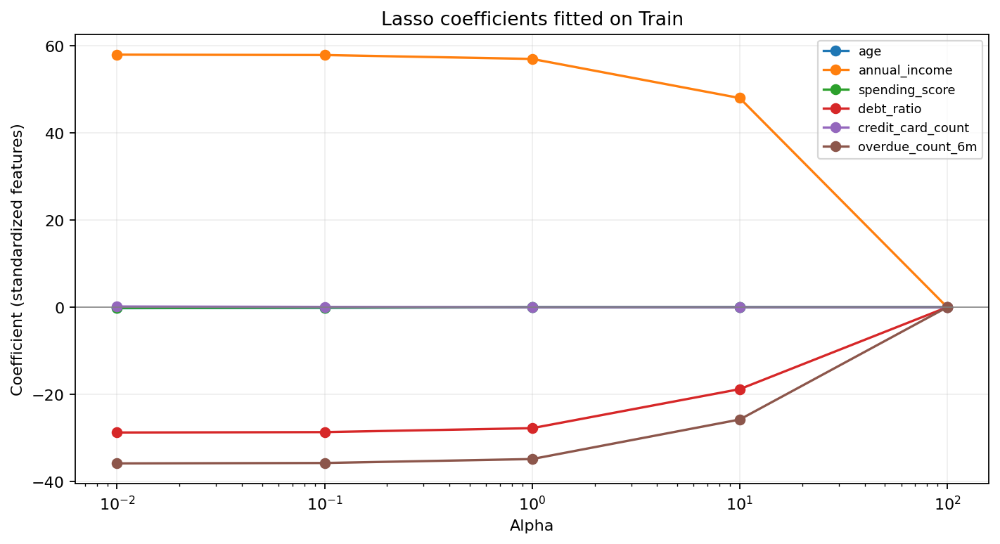
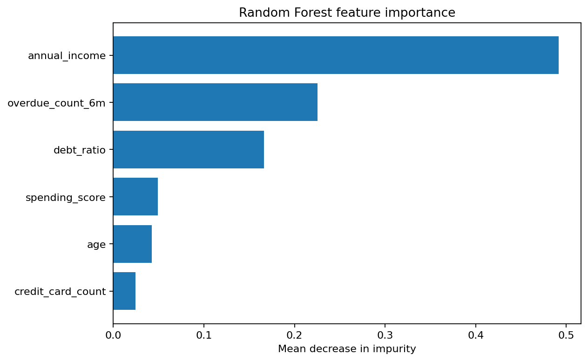

# A5_1
대출을 해줘도 될지 AI가 대신 판단해주는 시스템 만들기

동일한 합성 고객 데이터에서 신용 점수 회귀와 연체 여부 분류를 학습하고, 규칙 기반 모델과 머신러닝 모델의 성능을 비교하는 학습 프로젝트다. 회귀에는 Ridge·Lasso, 분류에는 Logistic Regression·Random Forest를 사용한다. 성능 수치와 해석은 고정된 Test 2,000건에서 얻은 결과를 기준으로 한다.

## 데이터와 예측 대상

데이터 생성 출처는 미션 문서의 첫 번째 데이터 생성 코드 블록이며, `data_gen.py`가 해당 생성 규칙을 구현한다. 10,000명의 가상 고객에 대해 연소득·최근 연체 횟수·부채비율과 잡음으로 신용 점수를 생성하고, 낮은 신용 점수와 난수 조건으로 연체 여부를 생성한다. 출처와 요구사항은 [미션 문서](docs/A5_1_mission.md)에 있다.

| 입력 특성 | 의미 |
| --- | --- |
| `age` | 나이 |
| `annual_income` | 연소득, 단위 만원 |
| `spending_score` | 소비 점수 |
| `debt_ratio` | 소득 대비 부채 비율 |
| `credit_card_count` | 보유 신용카드 수 |
| `overdue_count_6m` | 최근 6개월 연체 횟수 |

회귀 타겟은 `credit_score`이며 반환 범위는 0~1000이다. 분류 타겟은 `is_overdue`이며 1은 연체, 0은 정상이다. 두 타겟을 모두 입력 특성에서 제외하고 6개 수치형 입력만 사용한다. 원자료는 로컬 `finance_data.csv`에 보관하며 `*.csv`를 Git에서 제외한다.

## 환경과 실행 순서

Python 3.11과 `uv`가 설치된 PowerShell에서 저장소 루트를 작업 디렉터리로 사용한다. 직접 의존성의 고정 버전은 NumPy 1.26.4, pandas 2.2.3, scikit-learn 1.6.1, Matplotlib 3.10.1, seaborn 0.13.2다. 설치 명세는 [requirements.txt](requirements.txt)에 있다.

먼저 오류 중단 함수와 Python 버전을 설정한다. 로컬 검증과 동일하게 `uv` 캐시를 사용하지 않도록 설정한다.

```powershell
$ErrorActionPreference = 'Stop'
function Invoke-Local {
    param([scriptblock]$Command)
    & $Command
    if ($LASTEXITCODE -ne 0) {
        throw "로컬 명령 실패, 종료 코드 $LASTEXITCODE"
    }
}
$env:UV_PYTHON = '3.11'
$env:UV_NO_CACHE = '1'
```

신규 환경에서는 로컬에 설치된 Python 3.11로 `.venv`를 만들고 의존성을 설치한다.

```powershell
Invoke-Local { uv venv --no-python-downloads .venv }
Invoke-Local { uv pip install --python .venv -r requirements.txt }
```

기존 `.venv`는 Python 3.11과 고정 의존성 버전이 일치할 때 재사용한다. 다음 순서로 Python 버전과 의존성 충돌 여부를 확인한다.

```powershell
Invoke-Local { uv run --python .venv python -B -X utf8 -c "import sys; assert sys.version_info[:2] == (3, 11)" }
Invoke-Local { uv pip check --python .venv }
```

데이터 최초 생성 시 다음 명령을 실행한다. 기존 CSV는 미션 생성 규칙과 스키마·수치가 검증된 자료를 재사용한다. `data_gen.py`를 기존 CSV에 실행하면 형태·열 순서·수치형 여부와 생성값 일치를 확인하며 수치 비교 허용오차는 `rtol=1e-12`, `atol=1e-12`다. 불일치는 오류로 처리한다.

```powershell
Invoke-Local { uv run --python .venv python -B -X utf8 data_gen.py }
```

검증된 데이터가 준비되면 전처리를 검증하고 모델링을 실행한다.

```powershell
Invoke-Local { uv run --python .venv python -B -X utf8 preprocess.py --validate }
Invoke-Local { uv run --python .venv python -B -X utf8 modeling.py --validate }
```

`modeling.py --validate` 한 번으로 학습·Train 전용 CV·Test 평가·그림 저장·산출물 검증을 마친다. `predict_credit_score()`는 신용 점수 배열을, `predict_overdue_probability()`는 클래스 1의 확률 배열을 반환한다. 집계 결과와 검증 기록은 [metrics.json](artifacts/metrics.json)에 저장된다.

## 재현성과 데이터 누수 방지

- 공통 분할 함수로 Train 8,000건과 Test 2,000건을 만들고 `stratify=is_overdue`, `random_state=42`를 적용한다. 회귀와 분류의 표본 인덱스가 일치한다.
- 수치형 입력에는 중앙값 대치와 `StandardScaler`를 적용한다. 공통 전처리 함수는 범주형 대치와 `OneHotEncoder(handle_unknown='ignore')` 경로도 제공하며 현재 데이터의 범주형 선택 목록은 비어 있다.
- 모든 CV가 전처리를 포함한 전체 `Pipeline`을 탐색하여 전처리 통계가 각 학습 폴드에서 fit되게 한다. 최종 선택 모델은 Train 전체로 fit하고 Test를 최종 평가에 사용한다.
- Ridge·Lasso는 Alpha `[0.01, 0.1, 1, 10, 100]`을 5-fold `KFold(shuffle=True, random_state=42)`에서 비교하고 평균 CV RMSE로 선택한다. 각 Alpha의 계수 그래프는 Train에서 fit한 계수를 사용한다.
- Random Forest는 `n_estimators=[100, 200]`, `max_depth=[None, 8]`, `min_samples_leaf=[1, 3, 5]`의 12개 조합을 5-fold `StratifiedKFold(shuffle=True, random_state=42)`와 `scoring='f1'`로 탐색한다. 최적값은 트리 200개, 깊이 제한 없음, 최소 리프 표본 5개이며 평균 CV F1은 0.6757이다.
- Logistic Regression·Random Forest에 `class_weight='balanced'`를 적용하고 재현 가능한 추정기의 `random_state`를 42로 고정한다. Train 양성 비율은 12.0125%, Test는 12.0000%다.

## 분류 성능

행 순서와 수치는 `metrics.json`의 `classification` 결과를 따르며 소수점 4자리로 표시한다.

| 모델 | Accuracy | Precision | Recall | F1-Score | AUC |
| --- | --- | --- | --- | --- | --- |
| Rule-based | 0.5100 | 0.1901 | 0.9458 | 0.3166 | 0.6982 |
| Logistic Regression | 0.8785 | 0.4965 | 0.8750 | 0.6335 | 0.9505 |
| Random Forest | 0.9030 | 0.5697 | 0.7833 | 0.6596 | 0.9423 |

규칙 모델은 최근 연체 3회 이상, 부채비율 0.7 초과, 소득 3000 미만, 카드 7개 초과, 최근 연체 1회 이상이면서 부채비율 0.5 초과의 다섯 조건을 순서대로 적용한다. 해당 조건에 걸리면 1을 반환하고 마지막에 0을 반환한다. 이 0/1 출력을 규칙 AUC와 ROC의 점수로 사용한다. ML 모델의 AUC와 ROC는 `predict_proba`의 양성 확률로 계산한다.

분류 임계값은 0.5로 고정하여 점수가 0.5 이상이면 연체로 판정한다. Precision은 연체로 판정한 고객 중 실제 연체 비율이고, Recall은 실제 연체 고객 중 발견한 비율이다. 임계값을 낮추면 양성 판정이 늘어나 발견율과 오탐 사이의 균형이 달라진다. Precision·Recall·F1에는 `zero_division=0`을 적용한다.

양성이 12%인 Test에서는 다수 클래스의 정답이 Accuracy에 크게 기여하므로 Precision·Recall·F1·AUC를 함께 해석한다. `class_weight='balanced'`는 클래스 빈도에 반비례하는 가중치를 적용해 소수 클래스의 학습 기여를 높인다.

리샘플링은 소수 클래스 표본을 늘리거나 다수 클래스 표본을 줄여 학습 분포를 조정하는 방식이다. SMOTE는 소수 클래스의 이웃 표본 사이를 보간해 합성 표본을 만든다. 리샘플링을 적용할 때는 각 CV 학습 폴드 내부에서 수행해 검증·Test 데이터로 정보가 유입되는 것을 방지한다. 이번 실험은 원본 표본을 유지하고 클래스 가중치로 불균형을 처리했다.

규칙 대비 Logistic Regression의 F1은 0.3169 증가했고 상대 개선율은 100.09%다. Random Forest의 F1은 0.3431 증가했고 상대 개선율은 108.36%다. 개선율은 반올림 전 지표로 `(ML F1 / 규칙 F1 - 1) × 100`을 계산했다. RF의 F1과 Precision이 가장 높고, LR의 AUC가 가장 높다. 규칙 모델은 Recall 0.9458과 Precision 0.1901을 기록하여 넓은 위험 판정 범위에 따른 오탐이 많다. RF의 Recall은 0.7833, LR은 0.8750으로 규칙 모델보다 낮아 탐지율의 절충이 있다.

RF 혼동행렬은 행을 실제값, 열을 예측값으로 하며 양쪽 순서는 `[0, 1]`이다. TN 1,618건, FP 142건, FN 52건, TP 188건이며 합계는 Test 2,000건이다.


## 회귀 성능과 규제

수치는 `metrics.json`의 `regression` 결과이며 소수점 4자리로 표시한다. CV 선택과 최종 RMSE·MAE·R²는 모두 정상 예측 진입점이 0~1000으로 clipping하여 반환하는 신용 점수에 근거한다.

| 모델 | Alpha | RMSE | MAE | R² |
| --- | --- | --- | --- | --- |
| Ridge | 1.0000 | 30.1259 | 23.9328 | 0.8612 |
| Lasso | 0.1000 | 30.1284 | 23.9297 | 0.8612 |

RMSE와 MAE는 신용 점수 단위의 오차이며 RMSE는 큰 오차에 더 민감하다. R²는 Test 타겟의 변동을 설명하는 정도다. Ridge의 RMSE가 약간 낮고 Lasso의 MAE가 약간 낮으며 두 모델의 Test 성능은 가깝다.

Ridge의 L2 규제는 계수 제곱합을, Lasso의 L1 규제는 계수 절댓값 합을 벌점으로 사용한다. Alpha를 키우면 벌점의 영향이 커진다. 그래프는 표준화된 입력의 계수를 표시한다. Ridge에서 Alpha가 0.01에서 100으로 증가하면 연소득 계수는 약 58.0144에서 57.2983으로, 최근 연체 횟수 계수는 약 -35.8708에서 -35.4231로 변한다. 주요 계수의 절댓값이 완만하게 줄어든다.

Lasso는 Alpha 1에서 나이·소비 점수·카드 개수의 계수가 0이 되며, Alpha 100에서는 모든 입력 계수가 0이 된다. 이는 규제 강화에 따른 변수 선택과 과도한 축소를 보여준다. 최종 Alpha는 Test 비교에 앞서 Train CV로 선택한 Ridge 1과 Lasso 0.1이다.




## 특징 중요도



- 연소득의 상대 중요도는 49.16%로 가장 높으며, 이 Random Forest에서 가장 큰 불순도 감소 기여를 보였다.
- 최근 6개월 연체 횟수 22.57%와 부채비율 16.65%가 뒤를 이으며, 상위 세 특성의 합은 전체 중요도의 88.38%다.
- 중요도는 현재 합성 데이터에 학습한 모델의 상대적 예측 기여도를 나타내며, 영향 방향과 인과관계는 별도의 분석이 필요하다.

## 결과의 적용 범위와 검증

회귀 타겟을 선형 관계와 잡음으로 만들었기 때문에 선형 모델이 데이터 구조를 잘 포착한다. 분류 타겟에는 확률적 잡음이 포함되어 있고, 결과는 하나의 고정된 합성 데이터 분할에 대한 측정이다. 실제 금융 데이터에서의 일반화 성능과 비용에 따른 임계값 선택은 별도 평가가 필요하다. 규칙은 조건별 설명이 쉽고 ML은 이 Test에서 F1·AUC가 높지만, ML의 학습·튜닝·전처리 관리에는 추가 작업이 따른다.

저장된 모델링 검증 결과는 `passed`다. 검증은 6개 특성·타겟 제외·분할 인덱스, Train 전용 전처리 통계와 CV 설정·후보 수, Test 예측 길이·유한성·범위, 실제 예측 기반 지표 재계산, ROC/AUC 대응, 2×2 혼동행렬 합계, 특징 중요도 대응, PNG 존재·비어 있지 않음·디코딩, JSON 계약과 저장 결과 일치를 포함한다. 작업 3에서는 기존 산출물과 README의 지표 행·그림 경로·실행 명령을 대조한다.

운영은 작업당 최대 2턴으로 제한하며 첫 오류 발생 시 즉시 중단한다. 모든 `GridSearchCV`는 `verbose=0`, 탐색당 전체 조합 50개 이하로 제한한다. 그림은 `pyplot` import 전에 `matplotlib.use('Agg')`를 설정하고 `savefig`·`close`로 파일에 저장한다. CSV 내용 출력과 임의 데이터 변경을 제한하며, 검증 배치에서 `git check-ignore --no-index -- finance_data.csv`와 `git ls-files -- '*.csv'`로 제외 및 추적 목록을 확인한다. 커밋은 대상 경로만 스테이징하고 `git diff --cached --check` 성공 후 기능 단위로 로컬에 기록한다. 사용자 원격 반영과 저장소 URL 제출은 최종 인계 절차다.

## 주요 파일과 문서

| 경로 | 역할 |
| --- | --- |
| `data_gen.py` | 미션 규칙의 합성 데이터 생성 및 기존 CSV 일치 확인 |
| `preprocess.py`, `src/preprocess.py` | 공통 API·CLI, 스키마·분할·전처리 구현 및 검증 |
| `baseline.py` | 원본 입력에 대한 다섯 조건의 규칙 예측 |
| `modeling.py` | 회귀·분류 학습, Train CV, 정상 예측 함수, Test 평가·검증 |
| `artifacts/metrics.json` | 실제 집계 지표·CV 결과·계수 경로·중요도·검증 기록 |
| `artifacts/*.png` | 계수 그래프 두 개, 혼동행렬, ROC, 특징 중요도 |
| `requirements.txt` | 고정된 직접 의존성 버전 |
| `docs/A5_1_mission.md` | 미션 원문과 데이터 생성 출처 |
| `plans/A5_1.md` | 요구사항 추적표와 작업 1~3 실행·검증 계약 |
| `AGENTS.md`, `log_history.md` | 공통 운영 규칙과 KST 기준 작업 완료 이력 |

선행 로컬 커밋은 데이터 생성·전처리 `0c22f17`, 모델링 `d796c6c`다. 문서화 커밋은 `docs: report`이며 README·계획·완료 이력을 포함한다. 실행·산출물 계약은 [통합 계획](plans/A5_1.md), 작업 기록은 [완료 이력](log_history.md)에서 확인할 수 있다.

## 보너스 과제

필수 구현·리포트와 계획의 로컬 작업 1~3은 완료했으며, 미션 5절의 보너스 과제 진행 상태는 다음과 같다.

| 보너스 항목 | 상태 | 구현 근거 또는 남은 작업 |
| --- | --- | --- |
| Custom Transformer | 미구현 | `BaseEstimator`를 상속하고 `fit`·`transform`을 제공하는 사용자 정의 전처리 클래스 구현이 남아 있다. |
| 모듈화 | 완료 | 데이터 생성은 `data_gen.py`, 전처리는 `preprocess.py`·`src/preprocess.py`, 규칙 예측은 `baseline.py`, 학습·평가는 `modeling.py`로 분리했다. 위 실행 순서의 CLI로 각 단계를 실행할 수 있다. |
| Learning Curve 분석 | 미구현 | 학습 데이터 크기별 Train·Validation 성능을 계산하고 학습 곡선을 저장한 뒤 편향·분산을 해석하는 작업이 남아 있다. |
