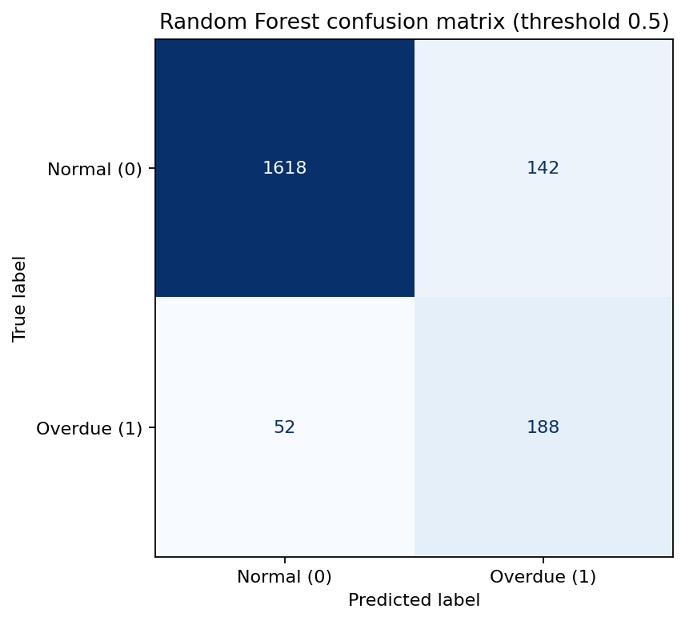
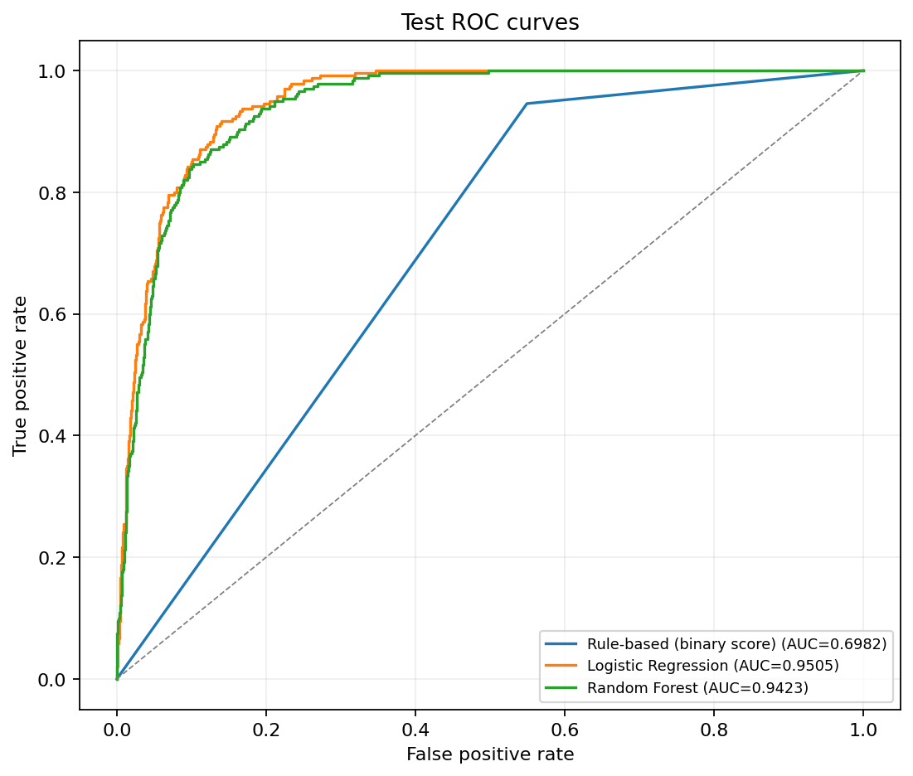
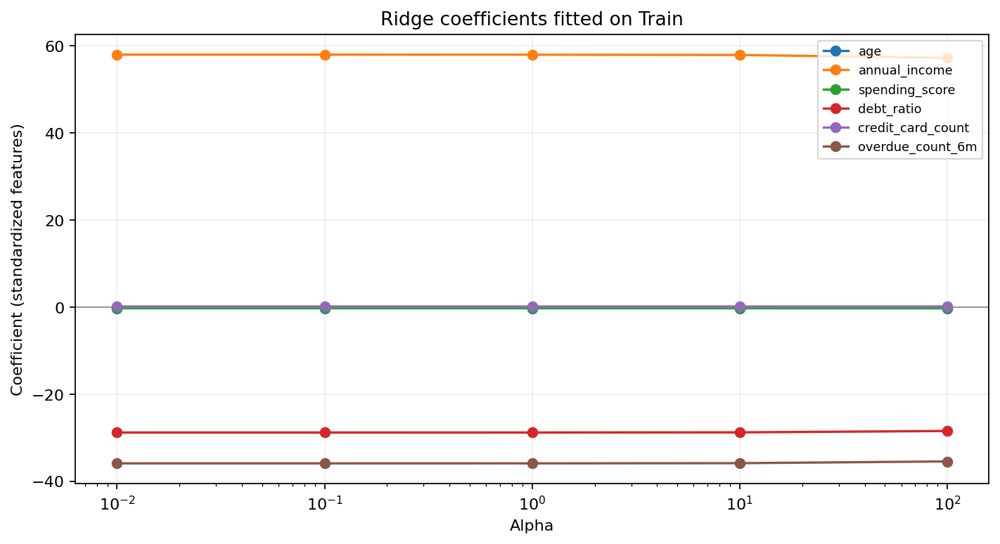
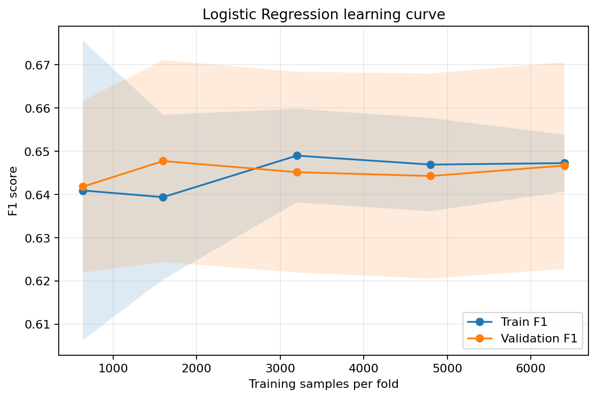

# A5_1
대출을 해줘도 될지 AI가 대신 판단해주는 시스템 만들기

동일한 합성 고객 데이터에서 신용 점수 회귀와 연체 여부 분류를 학습하고, 규칙 기반 모델과 머신러닝 모델의 성능을 비교하는 학습 프로젝트다. 회귀에는 Ridge·Lasso, 분류에는 Logistic Regression·Random Forest를 사용한다. 기본 성능 수치와 해석은 고정된 Test 2,000건에서 얻은 결과를 기준으로 하며, 보완 비교표는 Train 내부 CV와 운영 측정의 범위를 각각 표시한다.

## 데이터와 예측 대상

데이터 생성 출처는 미션 문서의 첫 번째 데이터 생성 코드 블록이며, `data_gen.py`가 해당 생성 규칙을 구현한다. 10,000명의 가상 고객에 대해 연소득·최근 연체 횟수·부채비율과 잡음으로 신용 점수를 생성하고, 낮은 신용 점수와 난수 조건으로 연체 여부를 생성한다. 출처와 요구사항은 [미션 문서](docs/A5_1_mission.md)에 있다.

| 입력 특성 | 의미 |
| --- | --- |
| `age` | 나이 |
| `annual_income` | 연소득, 단위 만원 |
| `spending_score` | 소비 점수 |
| `debt_ratio` | 소득 대비 부채 비율 |
| `credit_card_count` | 보유 신용카드 수 |
| `overdue_count_6m` | 최근 6개월 연체 횟수 |

회귀 타겟은 `credit_score`이며 반환 범위는 0~1000이다. 분류 타겟은 `is_overdue`이며 1은 연체, 0은 정상이다. 두 타겟을 모두 입력 특성에서 제외하고 6개 수치형 입력만 사용한다. 원자료는 로컬 `finance_data.csv`에 보관하며 `*.csv`를 Git에서 제외한다.

## 환경과 실행 순서

Python 3.11과 `uv`가 설치된 PowerShell에서 저장소 루트를 작업 디렉터리로 사용한다. 직접 의존성의 고정 버전은 NumPy 1.26.4, pandas 2.2.3, scikit-learn 1.6.1, Matplotlib 3.10.1, seaborn 0.13.2, imbalanced-learn 0.14.0이다. 선택 허용 라이브러리인 imbalanced-learn은 SMOTE 비교 실험에 사용한다. 설치 명세와 버전별 의존성은 각 자료에 명시되어 있다. [requirements.txt](requirements.txt), [imbalanced-learn 0.14.0](https://pypi.org/project/imbalanced-learn/0.14.0/)

신규 환경에서는 로컬에 설치된 Python 3.11로 `.venv`를 만들고 의존성을 설치한다. 기존 환경에 SMOTE 의존성을 추가할 때는 설치 명령을 실행한다.

```powershell
$ErrorActionPreference = 'Stop'
uv venv --no-python-downloads .venv
if ($LASTEXITCODE -ne 0) { throw '가상환경 생성 실패' }
uv pip install --no-cache --python .venv -r requirements.txt
if ($LASTEXITCODE -ne 0) { throw '의존성 설치 실패' }
```

기존 `.venv`가 준비되어 있으면 다음 블록 전체를 복사해 의존성·데이터·전처리·모델링·보너스·보완 실험·문서 정합성을 순서대로 검증한다. `validate_report.py`는 Python 3.11과 고정 의존성 버전도 확인한다.

```powershell
$ErrorActionPreference = 'Stop'
function Invoke-Local {
    param([scriptblock]$Command)
    & $Command
    if ($LASTEXITCODE -ne 0) {
        throw "로컬 명령 실패, 종료 코드 $LASTEXITCODE"
    }
}
$env:UV_PYTHON = '3.11'
$env:UV_NO_CACHE = '1'
Invoke-Local { uv pip check --python .venv }
Invoke-Local { uv run --python .venv python -B -X utf8 data_gen.py }
Invoke-Local { uv run --python .venv python -B -X utf8 preprocess.py --validate }
Invoke-Local { uv run --python .venv python -B -X utf8 modeling.py --validate }
Invoke-Local { uv run --python .venv python -B -X utf8 bonus.py --validate }
Invoke-Local { uv run --python .venv python -B -X utf8 evaluation.py --validate }
Invoke-Local { uv run --python .venv python -B -X utf8 validate_report.py --refresh --validate }
```

데이터 최초 생성 메시지는 `Generated finance_data.csv.`이고, 기존 CSV의 형태·열 순서·수치형 여부와 생성값이 일치하면 `Existing finance_data.csv verified and reused.`를 출력한다. 생성값 비교 허용오차는 `rtol=1e-12`, `atol=1e-12`다. 요약은 `Samples=10000, overdue_rate=12.0100%`이며, 전처리 검증에서 Train/Test 8,000/2,000건과 두 타겟의 동일 분할을 확인한다. 생성 규칙·재사용 검증과 전처리 검증의 구현을 각 파일에서 확인할 수 있다. [데이터 생성·재사용](data_gen.py), [전처리 검증](src/preprocess.py)

`modeling.py --validate` 한 번으로 학습·Train 전용 CV·Test 평가·기본 그림 5개 저장·산출물 검증을 마친다. `predict_credit_score()`는 신용 점수 배열을, `predict_overdue_probability()`는 클래스 1의 확률 배열을 반환한다. 규칙별 적용 건수·TP·FP와 규칙 대비 F1 향상도 함께 출력·저장한다. 보너스 검증은 학습 곡선을, `evaluation.py --validate`는 불균형 처리·앙상블·추론 자원·비용 임계값 비교를 생성한다. [기본 모델 결과](artifacts/metrics.json), [보너스 결과](artifacts/bonus_metrics.json), [보완 실험 결과](artifacts/evaluation_metrics.json)

| 단계 | 수행 내용 | 구현·산출물 |
| --- | --- | --- |
| 데이터 준비 | 미션 생성 규칙과 기존 CSV 일치 확인 또는 신규 생성 | `data_gen.py` |
| 공통 분할 | 두 타겟에 동일한 Train/Test 인덱스 적용 | `src/preprocess.py`의 `split_data()` |
| 폴드 학습 | 각 CV 학습 폴드에서 전처리 fit 후 모델 학습 | `make_preprocessor()`, `modeling.py`, `evaluation.py` |
| 설정 선택 | Train CV로 Alpha·RF 파라미터 선택, 검증 예측으로 비용 임계값 선택 | `modeling.py`, `evaluation.py` |
| 최종 학습·평가 | 전체 Train 재학습 후 원분포 Test 최종 평가, 원본 입력 규칙 비교 | `modeling.py`, `baseline.py`, `evaluation.py` |
| 저장·대조 | 집계 JSON·PNG 저장 후 README 수치와 근거 연결 확인 | `artifacts/`, `validate_report.py` |

## 재현성과 데이터 누수 방지

- 공통 분할 함수로 Train 8,000건과 Test 2,000건을 만들고 `stratify=is_overdue`, `random_state=42`를 적용한다. 회귀와 분류의 표본 인덱스가 일치한다.
- `make_preprocessor()`는 수치형 6개 열을 `TrainingMedianImputer`로 Train 중앙값 대치한 뒤 `StandardScaler`를 적용하는 `ColumnTransformer`를 만든다. 선택적 범주형 경로는 `SimpleImputer(strategy="most_frequent")`와 `OneHotEncoder(handle_unknown="ignore")`를 사용하며, 원본 데이터의 범주형 선택 목록은 비어 있다. 전처리 구성은 공통 함수에서 확인할 수 있다. [전처리 구현](src/preprocess.py)
- 모든 CV가 전처리를 포함한 전체 `Pipeline`을 탐색하여 전처리 통계가 각 학습 폴드에서 fit되게 한다. 최종 선택 모델은 Train 전체로 fit하고 Test를 최종 평가에 사용한다.
- Ridge·Lasso는 Alpha `[0.01, 0.1, 1, 10, 100]`을 5-fold `KFold(shuffle=True, random_state=42)`에서 비교하고 평균 CV RMSE로 선택한다. 각 Alpha의 계수 그래프는 Train에서 fit한 계수를 사용한다.
- Random Forest는 `n_estimators=[100, 200]`, `max_depth=[None, 8]`, `min_samples_leaf=[1, 3, 5]`의 12개 조합을 5-fold `StratifiedKFold(shuffle=True, random_state=42)`와 `scoring='f1'`로 탐색한다. 최적값은 트리 200개, 깊이 제한 없음, 최소 리프 표본 5개이며 평균 CV F1은 0.6757이다.
- Logistic Regression·Random Forest에 `class_weight='balanced'`를 적용하고 재현 가능한 추정기의 `random_state`를 42로 고정한다. Train 양성 비율은 12.0125%, Test는 12.0000%다.

| 구분 | 입력·분할·전처리 | 개별 처리 |
| --- | --- | --- |
| 공통 ML | 6개 입력, 두 타겟 제외, 동일 Train/Test 인덱스, 학습 폴드 전용 대치·스케일링 | 검증·Test에는 학습된 변환 적용 |
| 회귀 | 공통 전처리 사용 | KFold, CV RMSE로 Alpha 선택, 신용 점수 0~1000 clipping |
| 분류 | 공통 전처리 사용 | 클래스 가중치 또는 비교 실험의 SMOTE, RF의 StratifiedKFold·F1 탐색, 양성 확률과 임계값 판정 |
| 규칙 | 원본 수치형 입력 사용 | 다섯 `if/elif` 조건과 최종 정상 반환 |

## 분류 성능

행 순서와 수치는 `metrics.json`의 `classification` 결과를 따르며 소수점 4자리로 표시한다.

| 모델 | Accuracy | Precision | Recall | F1-Score | AUC |
| --- | --- | --- | --- | --- | --- |
| Rule-based | 0.5100 | 0.1901 | 0.9458 | 0.3166 | 0.6982 |
| Logistic Regression | 0.8785 | 0.4965 | 0.8750 | 0.6335 | 0.9505 |
| Random Forest | 0.9030 | 0.5697 | 0.7833 | 0.6596 | 0.9423 |

규칙 모델은 최근 연체 3회 이상, 부채비율 0.7 초과, 소득 3000 미만, 카드 7개 초과, 최근 연체 1회 이상이면서 부채비율 0.5 초과의 다섯 조건을 순서대로 적용한다. 해당 조건에 걸리면 1을 반환하고 마지막에 0을 반환한다. 이 0/1 출력을 규칙 AUC와 ROC의 점수로 사용한다. ML 모델의 AUC와 ROC는 `predict_proba`의 양성 확률로 계산한다.

| 규칙 | 첫 매칭 조건 | 적용 건수 | TP | FP |
| --- | --- | --- | --- | --- |
| 1 | `overdue_count_6m >= 3` | 26 | 16 | 10 |
| 2 | `debt_ratio > 0.7` | 594 | 130 | 464 |
| 3 | `annual_income < 3000` | 198 | 62 | 136 |
| 4 | `credit_card_count > 7` | 275 | 7 | 268 |
| 5 | `overdue_count_6m >= 1 and debt_ratio > 0.5` | 101 | 12 | 89 |

규칙은 위에서 처음 충족한 조건에만 귀속하므로 적용 건수와 TP·FP의 중복이 없다. 적용 합계는 1,194건, TP 합계는 227건, FP 합계는 967건이며 최종 정상 반환은 806건이다. 규칙 기여와 F1 향상은 모델링 CLI가 출력하고 JSON으로 저장하며, README 표는 `validate_report.py`가 같은 결과와 대조한다. [규칙 집계 구현](baseline.py), [규칙별 집계·F1 향상](artifacts/metrics.json)

기본 분류 성능 표의 임계값은 0.5로 고정하여 점수가 0.5 이상이면 연체로 판정한다. Precision은 연체로 판정한 고객 중 실제 연체 비율이고, Recall은 실제 연체 고객 중 발견한 비율이다. 임계값을 낮추면 양성 판정이 늘어나 발견율과 오탐 사이의 균형이 달라진다. Precision·Recall·F1에는 `zero_division=0`을 적용한다.

Test 2,000건 중 정상 1,760건·연체 240건을 모두 정상으로 예측하면 Accuracy는 88%이지만 연체 Recall과 F1은 0이다. LR은 Accuracy 87.85%와 Recall 87.50%를 기록하므로, 연체 탐지 목적에서는 Precision·Recall·F1·AUC를 함께 해석한다. `class_weight='balanced'`는 클래스 빈도에 반비례하는 가중치를 적용해 소수 클래스의 학습 기여를 높인다.

리샘플링은 소수 클래스 표본을 늘리거나 다수 클래스 표본을 줄여 학습 분포를 조정하는 방식이다. SMOTE는 소수 클래스의 이웃 표본 사이를 보간해 합성 표본을 만든다. 리샘플링을 적용할 때는 각 CV 학습 폴드 내부에서 수행해 검증·Test 데이터로 정보가 유입되는 것을 방지한다. 기본 분류 모델은 원본 표본을 유지하고 클래스 가중치로 불균형을 처리하며, 보완 실험은 동일한 Train 폴드에서 무보정·가중치·SMOTE를 비교한다. 가중치 방식은 표본 수를 유지하면서 소수 클래스의 학습 기여를 높이며, 오탐과 미탐의 균형이 설정에 따라 달라진다. Test는 운영에서 만날 클래스 비율과 표본 구성을 유지해 최종 평가에 사용한다. 분할 전 리샘플링은 학습·평가 간 정보 유입을 일으킬 수 있고, Test를 증감·합성하면 평가 대상과 분포가 바뀌므로 리샘플링은 각 CV 학습 폴드 내부에서 수행한다.

규칙 대비 Logistic Regression의 F1은 0.3169 증가했고 상대 개선율은 100.09%다. Random Forest의 F1은 0.3431 증가했고 상대 개선율은 108.36%다. 개선율은 반올림 전 지표로 `(ML F1 / 규칙 F1 - 1) × 100`을 계산했다. RF의 F1과 Precision이 가장 높고, LR의 AUC가 가장 높다. 규칙 모델은 Recall 0.9458과 Precision 0.1901을 기록하여 넓은 위험 판정 범위에 따른 오탐이 많다. RF의 Recall은 0.7833, LR은 0.8750으로 규칙 모델보다 낮아 탐지율의 절충이 있다.

RF 혼동행렬은 행을 실제값, 열을 예측값으로 하며 양쪽 순서는 `[0, 1]`이다. TN 1,618건, FP 142건, FN 52건, TP 188건이며 합계는 Test 2,000건이다.





## 회귀 성능과 규제

수치는 `metrics.json`의 `regression` 결과이며 소수점 4자리로 표시한다. CV 선택과 최종 RMSE·MAE·R²는 모두 정상 예측 진입점이 0~1000으로 clipping하여 반환하는 신용 점수에 근거한다.

| 모델 | Alpha | RMSE | MAE | R² |
| --- | --- | --- | --- | --- |
| Ridge | 1.0000 | 30.1259 | 23.9328 | 0.8612 |
| Lasso | 0.1000 | 30.1284 | 23.9297 | 0.8612 |

RMSE와 MAE는 신용 점수 단위의 오차이며 RMSE는 큰 오차에 더 민감하다. R²는 Test 타겟의 변동을 설명하는 정도다. Ridge의 RMSE가 약간 낮고 Lasso의 MAE가 약간 낮으며 두 모델의 Test 성능은 가깝다.

Ridge의 L2 규제는 계수 제곱합을, Lasso의 L1 규제는 계수 절댓값 합을 벌점으로 사용한다. Alpha를 키우면 벌점의 영향이 커진다. 그래프는 표준화된 입력의 계수를 표시한다. Ridge에서 Alpha가 0.01에서 100으로 증가하면 연소득 계수는 약 58.0144에서 57.2983으로, 최근 연체 횟수 계수는 약 -35.8708에서 -35.4231로 변한다. 주요 계수의 절댓값이 완만하게 줄어든다.

Lasso는 Alpha 1에서 나이·소비 점수·카드 개수의 계수가 0이 되며, Alpha 100에서는 모든 입력 계수가 0이 된다. 이는 규제 강화에 따른 변수 선택과 과도한 축소를 보여준다. 최종 Alpha는 Test 비교에 앞서 Train CV로 선택한 Ridge 1과 Lasso 0.1이다.



Ridge 그림에서 Alpha 0.01→100에 따라 연소득 계수는 58.0144→57.2983, 최근 연체 계수는 -35.8708→-35.4231로 변한다. L2 규제를 강화하면 주요 계수의 절댓값이 완만하게 줄어든다.


Lasso 그림에서 Alpha 1은 나이·소비 점수·카드 개수의 계수를 0으로 만들며, Alpha 100에서는 6개 계수가 모두 0이 된다. L1 규제의 변수 선택과 강한 축소를 보여준다.

| Alpha | Ridge CV RMSE 평균 ± 표준편차 | Lasso CV RMSE 평균 ± 표준편차 |
| --- | --- | --- |
| 0.01 | 29.5838 ± 0.5088 | 29.5831 ± 0.5094 |
| 0.1 | 29.5838 ± 0.5088 | 29.5774 ± 0.5147 |
| 1 | 29.5838 ± 0.5090 | 29.6090 ± 0.5643 |
| 10 | 29.5839 ± 0.5110 | 34.2606 ± 0.9238 |
| 100 | 29.6047 ± 0.5300 | 79.6935 ± 0.9758 |

표의 RMSE는 같은 5개 Train CV 검증 폴드에서 계산한 평균과 표준편차다. Ridge는 Alpha 0.01~10에서 평균 RMSE가 29.5838~29.5839로 가깝고, 반올림 전 평균이 가장 낮은 Alpha 1을 선택했다. Lasso는 Alpha 0.1의 평균 RMSE 29.5774가 가장 낮으며, Alpha 10에서 34.2606, 모든 계수가 0인 Alpha 100에서 79.6935로 증가한다. 강한 규제로 예측 관계가 축소되면서 과소적합이 커지는 양상이다. Alpha 선택과 최종 Test 성능을 각각의 표에서 확인할 수 있다. [Alpha별 원점수·평균·표준편차](artifacts/metrics.json)

## 특징 중요도


- 연소득의 상대 중요도는 49.16%로 가장 높으며, 이 Random Forest에서 가장 큰 불순도 감소 기여를 보였다.
- 최근 6개월 연체 횟수 22.57%와 부채비율 16.65%가 뒤를 이으며, 상위 세 특성의 합은 전체 중요도의 88.38%다.
- 중요도는 현재 합성 데이터에 학습한 모델의 상대적 예측 기여도를 나타내며, 영향 방향과 인과관계는 별도의 분석이 필요하다.

## 불균형 처리 비교

`evaluation.py`는 Train 8,000건을 같은 5개 층화 폴드로 나누고 LR의 무보정·`class_weight="balanced"`·SMOTE를 비교한다. 각 폴드의 학습 영역에서 전처리 통계를 구하고, SMOTE는 전처리→SMOTE→분류기를 묶은 `imblearn.pipeline.Pipeline`의 학습 단계에서만 적용한다. 검증 영역과 Test는 원본 표본을 유지한다. 학습시간에는 전처리와 SMOTE가 포함된다. [비교 구현](evaluation.py), [비교 결과](artifacts/evaluation_metrics.json)

| 처리 | CV Precision | CV Recall | CV F1 | CV AUC | 평균 학습시간(초) |
| --- | --- | --- | --- | --- | --- |
| 무보정 | 0.7295 | 0.5401 | 0.6201 | 0.9537 | 0.0105 |
| 클래스 가중치 | 0.4992 | 0.9189 | 0.6467 | 0.9538 | 0.0110 |
| SMOTE | 0.5135 | 0.9043 | 0.6548 | 0.9538 | 0.0198 |

수치는 동일한 5개 검증 폴드의 평균이며, 폴드별 원점수와 표준편차는 JSON에 저장한다. SMOTE의 CV F1은 0.6548로 클래스 가중치의 0.6467보다 0.0082 높다. 클래스 가중치는 Recall 0.9189, SMOTE는 0.9043으로 연체 탐지율과 Precision·F1 사이에 절충이 있다. 클래스 가중치는 원본 표본 수를 유지하고, SMOTE는 합성 표본 생성과 이웃 계산을 포함하므로 학습시간도 함께 비교한다. [불균형 비교 원점수](artifacts/evaluation_metrics.json)

파라미터 탐색에 SMOTE를 연결할 때도 전체 Pipeline을 `GridSearchCV`에 전달한다. 다음 예시는 이웃 수 5인 한 조합을 5-fold CV로 비교하는 구성이다.

```python
from imblearn.over_sampling import SMOTE
from imblearn.pipeline import Pipeline
from sklearn.linear_model import LogisticRegression
from sklearn.model_selection import GridSearchCV, StratifiedKFold
from preprocess import make_preprocessor

pipeline = Pipeline([
    ("preprocess", make_preprocessor()),
    ("smote", SMOTE(random_state=42)),
    ("model", LogisticRegression(random_state=42, max_iter=2000)),
])
search = GridSearchCV(
    pipeline,
    {"smote__k_neighbors": [5]},
    cv=StratifiedKFold(n_splits=5, shuffle=True, random_state=42),
    scoring="f1", verbose=0, n_jobs=1, error_score="raise",
)
```

## 앙상블의 편향과 분산

깊은 결정 트리는 복잡한 관계를 학습할 수 있으며 학습 표본의 변화에 민감하다. RF는 부트스트랩 표본으로 학습한 여러 트리를 결합하고, 각 분할에서 특징을 무작위로 선택해 트리 간 상관과 예측 분산을 낮춘다. 부스팅은 앞선 모델의 오차를 순차적으로 보완하여 편향을 줄이는 접근이다. RF의 최소 리프 표본 5개는 작은 표본에 대한 세밀한 분기를 제한해 복잡도를 조절한다.

규칙 F1 0.3166에서 RF F1 0.6596으로 개선되었고, RF 최적 설정은 트리 200개·깊이 제한 없음·최소 리프 표본 5개, 평균 CV F1 0.6757이다. 추가 실험은 같은 Train 폴드에서 단일 트리와 이 RF의 Train/Validation F1 및 폴드 간 변동을 비교한다. Train/Validation 격차와 검증 점수 변동은 일반화 특성을 살피는 지표이며, 관측한 F1 차이만으로 편향·분산의 감소량을 직접 산출할 수는 없다. [앙상블 비교 구현](evaluation.py), [앙상블 비교 결과](artifacts/evaluation_metrics.json)

| 모델 | Train F1 평균 ± 표준편차 | Validation F1 평균 ± 표준편차 | Train−Validation 격차 |
| --- | --- | --- | --- |
| Decision Tree | 0.6910 ± 0.0134 | 0.5531 ± 0.0110 | 0.1379 |
| Random Forest | 0.7904 ± 0.0037 | 0.6757 ± 0.0256 | 0.1147 |

RF는 단일 트리보다 Validation F1이 0.5531→0.6757로 높고 Train−Validation 격차는 0.1379→0.1147로 작았다. 검증 F1의 폴드 간 표준편차는 0.0110→0.0256으로 커졌다. 이 실험에서는 검증 성능과 일반화 격차의 개선을 관찰했으며, 폴드 점수의 변동과 이론적 예측 분산은 구분해 해석한다. RF 파라미터는 이전 Train CV 선택값을 고정한 조건부 비교이며, 편향·분산의 직접 분해량은 측정하지 않았다. [동일 폴드 비교 원점수](artifacts/evaluation_metrics.json)

## 운영 선택과 비용 임계값

운영 가정은 대출 사전심사에서 연체 미탐 손실을 우선 줄이면서 응답시간과 자원 한도를 만족하는 것이다. FP는 정상 고객을 위험 고객으로 판정해 발생하는 추가 심사·기회손실이고, FN은 연체 위험을 놓쳐 발생하는 대손 위험이다. 예시 비용을 FP 1단위·FN 10단위로 두면 임계값 0.5인 RF의 총비용은 `142 × 1 + 52 × 10 = 662`단위다. 실제 업무의 비용은 고객별 노출액·회수율·심사비용 등으로 산정한다.

`evaluation.py`는 Train 내부 교차검증으로 각 표본의 검증 확률을 한 번씩 생성하고, 임계값별 `FP × FP비용 + FN × FN비용`을 비교해 비용이 가장 낮은 임계값을 선택한다. 임계값과 운영 모델의 선택은 Test 평가에 앞서 고정한다. 임계값을 낮추면 양성 판정이 늘어 FN이 줄고 FP가 늘어나는 방향으로 바뀌므로 Precision·Recall도 함께 기록한다. 기본 결과의 임계값 0.5와 비용으로 선택한 임계값의 Test 결과를 나란히 제시한다. [비용 임계값 구현](evaluation.py), [선택·최종 평가 집계](artifacts/evaluation_metrics.json)

| 모델 | 선택 임계값 | Train OOF 선택 비용 | Test 기본 비용(0.5) | Test 선택 비용 | Test 선택 FP | Test 선택 FN |
| --- | --- | --- | --- | --- | --- | --- |
| Logistic Regression | 0.46 | 1627 | 513 | 472 | 232 | 24 |
| Random Forest | 0.21 | 1735 | 662 | 518 | 308 | 21 |

탐색 후보는 0.00~1.00의 0.01 간격과 전체 음성 판정 후보이며, 동률이면 FN·FP·임계값이 작은 순서로 고른다. Train OOF 선택 비용은 임계값을 고르는 데 사용한 튜닝 점수다. 모델과 임계값을 고정한 뒤 Test의 기본 비용과 선택 비용을 평가했다. LR은 임계값 0.5→0.46에서 Recall이 0.8750→0.9000, FP는 213→232, FN은 30→24로 변했다. RF는 0.5→0.21에서 Recall이 0.7833→0.9125, FP는 142→308, FN은 52→21로 변했다. 예시 비용에서는 미탐 감소가 오탐 증가를 상쇄하며, Test 비용 변화는 운영 모델 선택의 입력으로 사용하지 않았다. [임계값별 원점수·선택 근거](artifacts/evaluation_metrics.json)

동일 장비·동일 입력 크기에서 LR과 RF의 전처리 포함 추론시간을 측정한다. 단일 요청의 95백분위 지연시간, 일괄 처리량과 모델 자원 측정값을 기록하고, Train 검증 비용과 운영 제약으로 모델을 선택한다. 비용과 응답시간·자원 한도는 이 합성 데이터 실험을 위한 가정이며 실서비스 요구사항과 측정 환경에 맞춰 설정할 수 있다.

| 모델 | 단일 요청 p95(ms) | 일괄 처리량(건/초) | 직렬화 모델 크기(bytes) | Python 추적 추론 최대 할당(bytes) |
| --- | --- | --- | --- | --- |
| Logistic Regression | 1.9597 | 142131.4161 | 2793 | 117623 |
| Random Forest | 10.3244 | 17606.2392 | 8477926 | 112764 |

벤치마크는 Windows AMD64·Python 3.11.4에서 Train 입력을 사용하고 전처리를 포함했다. 5회 워밍업 후 단일 요청 100건의 p95와 256건 묶음 10회의 중앙 처리시간으로 처리량을 계산했다. Python 추적 최대 할당은 `tracemalloc`으로 256건 묶음 3회를 측정한 값이며, 네이티브 할당과 프로세스 전체 RSS는 측정 범위 밖이다. 직렬화 모델 크기는 pickle 바이트 수다. 시간·할당 값은 재실행 시 환경 부하에 따라 변할 수 있다.

이번 운영 가정은 단일 요청 p95 100ms 이하와 직렬화 모델 크기 10MiB 이하이며 두 모델이 충족했다. 제약을 만족한 후보 중 Train OOF 비용이 LR 1,627단위, RF 1,735단위여서 LR과 임계값 0.46을 선택했다. 동률이면 OOF FN, p95 지연시간, 모델 이름 순서로 결정한다. 이 선택은 미탐 손실을 크게 두는 예시 목적에 따른 것이며, F1 균형을 우선하는 업무에서는 RF의 기본 F1과 다른 비용·제약을 함께 검토할 수 있다. [측정 환경·운영 가정·선택 결과](artifacts/evaluation_metrics.json)

## 결과의 적용 범위와 검증

회귀 타겟을 선형 관계와 잡음으로 만들었기 때문에 선형 모델이 데이터 구조를 잘 포착한다. 분류 타겟에는 확률적 잡음이 포함되어 있고, 결과는 하나의 고정된 합성 데이터 분할에 대한 측정이다. 추가 실험의 비용 임계값은 합성 데이터와 예시 비용으로 선택했으며, 실제 금융 데이터의 일반화 성능과 업무별 비용은 해당 운영 데이터로 평가해야 한다. 규칙은 조건별 설명이 쉽고 ML은 이 Test에서 F1·AUC가 높지만, ML의 학습·튜닝·전처리 관리에는 추가 작업이 따른다.

저장된 모델링 검증 결과는 `passed`다. 검증은 6개 특성·타겟 제외·분할 인덱스, Train 전용 전처리 통계와 CV 설정·후보 수, Test 예측 길이·유한성·범위, 실제 예측 기반 지표 재계산, ROC/AUC 대응, 2×2 혼동행렬 합계, 특징 중요도 대응, PNG 존재·비어 있지 않음·디코딩, JSON 계약과 저장 결과 일치를 포함한다. 작업 3에서는 기존 산출물과 README의 지표 행·그림 경로·실행 명령을 대조한다.

공통 운영 지침은 작업당 최대 2턴과 첫 오류 발생 시 중단이다. 이번 보완 작업은 사용자의 추가 지시에 따라 코딩 오류를 수정하며 최종 검증까지 진행한다. 모든 `GridSearchCV`는 `verbose=0`, 탐색당 전체 조합 50개 이하로 제한한다. 그림은 `pyplot` import 전에 `matplotlib.use('Agg')`를 설정하고 `savefig`·`close`로 파일에 저장한다. CSV 내용 출력과 임의 데이터 변경을 제한하며, 검증 배치에서 `git check-ignore --no-index -- finance_data.csv`와 `git ls-files -- '*.csv'`로 제외 및 추적 목록을 확인한다. 커밋은 대상 경로만 스테이징하고 `git diff --cached --check` 성공 후 기능 단위로 로컬에 기록한다. 사용자 원격 반영과 저장소 URL 제출은 최종 인계 절차다.

## 주요 파일과 문서

| 경로 | 역할 |
| --- | --- |
| `data_gen.py` | 미션 규칙의 합성 데이터 생성 및 기존 CSV 일치 확인 |
| `preprocess.py`, `src/preprocess.py` | 공통 API·CLI, 스키마·분할·전처리 구현 및 검증 |
| `baseline.py` | 원본 입력에 대한 다섯 조건의 규칙 예측 |
| `modeling.py` | 회귀·분류 학습, Train CV, 정상 예측 함수, 규칙별 기여·F1 향상, Test 평가·검증 |
| `evaluation.py` | 불균형·앙상블 비교, 추론 자원 측정, 비용 임계값·운영 모델 선택 |
| `validate_report.py` | README 지표·표·산출물 링크와 저장 결과의 정합성 검증 |
| `artifacts/metrics.json` | 실제 집계 지표·CV 결과·계수 경로·중요도·규칙별 기여·F1 향상·검증 기록 |
| `artifacts/evaluation_metrics.json` | 불균형·앙상블·운영 자원·비용 임계값의 집계 결과 |
| `artifacts/*.png` | 계수 그래프 두 개, 혼동행렬, ROC, 특징 중요도 |
| `requirements.txt` | 고정된 직접 의존성 버전 |
| `docs/A5_1_mission.md` | 미션 원문과 데이터 생성 출처 |
| `plans/A5_1.md` | 요구사항 추적표와 작업 1~3 실행·검증 계약 |
| `AGENTS.md`, `log_history.md` | 공통 운영 규칙과 KST 기준 작업 완료 이력 |

선행 로컬 커밋은 데이터 생성·전처리 `0c22f17`, 모델링 `d796c6c`다. 문서화 커밋은 `docs: report`이며 README·계획·완료 이력을 포함한다. 실행·산출물 계약은 [통합 계획](plans/A5_1.md), 작업 기록은 [완료 이력](log_history.md)에서 확인할 수 있다.

## 보너스 과제

필수 구현·리포트와 계획의 로컬 작업 1~3은 완료했으며, 미션 5절의 보너스 과제 진행 상태는 다음과 같다.

| 보너스 항목 | 상태 | 구현 근거 |
| --- | --- | --- |
| Custom Transformer | 완료 | `src/preprocess.py`의 `TrainingMedianImputer`를 수치형 전처리 Pipeline에 연결했다. Train 중앙값 대치·전체 결측 열 처리·clone·특성 이름 대응을 검증했다. |
| 모듈화 | 완료 | 데이터 생성은 `data_gen.py`, 전처리는 `preprocess.py`·`src/preprocess.py`, 규칙 예측은 `baseline.py`, 학습·평가는 `modeling.py`로 분리했다. 위 실행 순서의 CLI로 각 단계를 실행할 수 있다. |
| Learning Curve 분석 | 완료 | `bonus.py`에서 Train 내부 5-fold CV로 학습 크기별 F1을 계산하고 `artifacts/learning_curve.png`와 `artifacts/bonus_metrics.json`에 결과를 저장한다. |

### Custom Transformer

`TrainingMedianImputer`는 `BaseEstimator`·`TransformerMixin`·`OneToOneFeatureMixin`을 상속한다. `fit`에서 학습 입력의 열별 중앙값을 `statistics_`에 저장하고, `transform`에서 결측값을 채운다. 학습 입력 전체가 결측인 열의 대치값은 0이다. 특성 이름·순서·차원을 검사하며, 새로 clone한 객체는 다시 학습한다. 수치형 Pipeline의 대치 단계로 사용하므로 모델 선택과 학습 곡선의 각 학습 폴드에서 중앙값을 계산한다.

### Learning Curve

기존 환경에서 다음 명령을 실행하면 Custom Transformer 검증과 학습 곡선 생성을 함께 수행한다.

```powershell
Invoke-Local { uv run --python .venv python -B -X utf8 bonus.py --validate }
```

분석 모델은 `class_weight='balanced'`인 Logistic Regression이며 하이퍼파라미터를 고정했다. Train 8,000건 내부에서 `StratifiedKFold(n_splits=5, shuffle=True, random_state=42)`를 사용한다. 각 폴드의 학습 영역 6,400건에 10%·25%·50%·75%·100%를 적용하고 검증 영역은 1,600건으로 유지한다. 전체 전처리 Pipeline을 각 부분집합에 fit하며 Test 2,000건은 이 분석에서 사용한 표본 수가 0이다. 아래 수치는 5개 폴드의 평균이고, 그림의 음영은 평균 ±1 표준편차다. 원점수·평균·표준편차·두 곡선의 격차는 별도 결과 파일에 기록한다. [보너스 결과](artifacts/bonus_metrics.json)

| 폴드별 학습 표본 수 | Train F1 | Validation F1 |
| --- | --- | --- |
| 640 | 0.6409 | 0.6418 |
| 1600 | 0.6394 | 0.6477 |
| 3200 | 0.6490 | 0.6451 |
| 4800 | 0.6469 | 0.6442 |
| 6400 | 0.6472 | 0.6467 |



- 최대 학습 크기에서 Train F1은 0.6472, Validation F1은 0.6467이며 격차는 약 0.0006이다. 두 곡선이 가까워 이 설정에서 과대적합에 따른 성능 격차는 작다.
- Validation F1은 학습 크기에 따라 0.6418~0.6477 범위에서 변한다. 비슷한 수준에서 정체되는 모양은 현재 선형 모델·특징과 생성 라벨의 잡음이 성능을 제한할 가능성을 보여준다.
- 학습 크기가 늘면서 Train 점수의 폴드별 표준편차는 줄어든다. Validation의 변동 폭은 유지되어 학습 크기 증가에 따른 안정화와 검증 표본 구성에 따른 분산을 함께 관찰할 수 있다.
